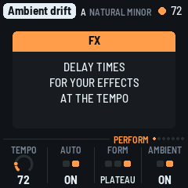
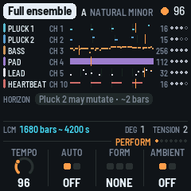
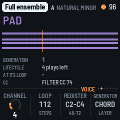
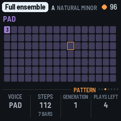
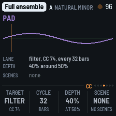
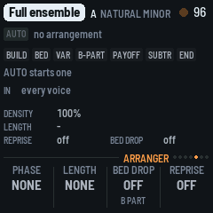
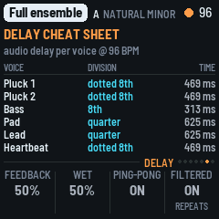
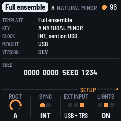

# Berlinan for the FM-1

Berlinan turns the M-VAVE FM-1 into a standalone Berlin School MIDI sequencer, the firmware version of
Berlinan for macOS. A small ensemble of voices (two plucks, a bass, a pad, a lead, a drone, a heartbeat) repeats,
phases against itself on loops of unequal length, and earns its mutations over time. The FM-1 makes no sound of its
own: plug it by USB into a MIDI router, and each voice goes out on its own MIDI channel to your synthesizers. You
play it from the panel: the keys, the buttons, the encoders and the screen. No laptop is needed once it is running.

---

## Contents

1. Install
2. Getting started
3. Controls
4. The pages
5. Saving
6. Sync
7. MASTER, the density fader
8. Berlinan on the Mac
9. Differences from Berlinan on the Mac
10. Troubleshooting
11. Credits

---

## 1. Install

You need the firmware package, `berlinan.fwsc` (`./build.sh` makes it in `app/build/`; see
[BUILDING.md](../BUILDING.md)), a USB data cable and Python 3 with `mido` and `python-rtmidi`
(`pip3 install mido python-rtmidi`). Connect the FM-1 and run, from the source folder:

```
python3 base/tools/fm1_install.py app/build/berlinan.fwsc
```

Don't unplug it while it is writing. When it finishes the FM-1 restarts into Berlinan and the script checks the
identity. (fm1-base can also build a web installer page, `base/tools/make_site.py`; Berlinan has no published site
yet, so the command line is the way.)

**Go back:** install M-VAVE's own firmware again (the FM-1 V15 file) with M-VAVE's updater, M-UPGRADE, or with the
same script (`fm1_install.py V15.fwsc`).

> Installing other firmware is at your own risk. If the FM-1 ever won't start, see
> [Recovering an FM-1 that won't start](#recovering-an-fm-1-that-wont-start).

---

## 2. Getting started

1. **Connect.** Plug the FM-1 into the router with USB. The router sees a MIDI device, "FM-Berlinan". Route its
   output to your synthesizers: each voice has its own channel (the Perform page shows them; the Voice page changes
   one).
2. **Play.** Press PLAY. The first piece is the Demo trio (Pluck 1, Bass, Pad) in A natural minor, from bar 1, with a
   new seed. The FM-1 sends MIDI Start and clock (INT sync).
3. **Mute and unmute.** Tap a voice key (F3 to B3): that voice goes quiet and its key goes dark. Tap again.
4. **Move the harmony.** Press a white key from C4: degrees 1 to 7, at the next bar.
5. **Change the piece.** Turn PRESETS: Demo trio, Full ensemble, Ambient drift. While playing it takes over at the next
   bar. EDIT re-rolls every unlocked voice; OCT+ is Dice, a new seed.
6. **Thin it out.** MASTER is the density: down thins the ensemble, the top is 100 %.
7. **Stop.** PLAY again. Every sounding note gets its note-off.

Not sure what a button does? Hold it for a second: a card says. Let go and nothing happens.

---

## 3. Controls

### Keys

| Keys | What they do |
|---|---|
| F3 F#3 G3 G#3 A3 A#3 B3 | The voices: Pluck 1, Pluck 2, Bass, Pad, Lead, Drone, Heartbeat. A press selects it. **Tap** (shorter than 1 s): also mute or unmute it. A voice the arranger holds back (it shows WAITS): the tap brings it in. **Hold** (1 s or more): selects it without muting, and EDIT, REC or SEL pressed meanwhile act on that voice (below). Lit: playing. Blinking: WAITS. Dark: muted, or not in this template. |
| C4 D4 E4 F4 G4 A4 B4 (white) | The degrees 1 to 7: the harmony moves diatonically at the next bar. The degree in force is lit; one that is coming blinks. |
| C#4 D#4 F#4 G#4 A#4 | CC scenes 1 to 5: the controllers morph toward the template's scene over 8 bars. Only the scenes the template has (Ambient drift: two; the others none; keys past them do nothing). The template's scenes are dim, the one the morph heads for is lit. |
| C5 C#5 D5 D#5 E5 F5 | Snapshot slots 1 to 6. Tap: recall it at the next bar (an empty slot says EMPTY). SAVE held + a slot: store the state there. Stored slots are lit. |
| F#5 | `>>`: the arranger's next change, at the next bar. |
| G5 | One unit of tension (on the pad voice, else the first voice). Lit while some is left. |

### Buttons

| Button | What it does |
|---|---|
| PLAY | Play and stop. It acts on the press and has no help card. INT: also MIDI Start, Stop and clock. Lit green while playing. |
| REC | The B part. With a voice key held: a blank cycle for that voice. |
| EDIT | Re-roll every unlocked voice. With a voice key held: regenerate that voice. |
| SEL | With a voice key held, or on the Voice page: lock or unlock the voice. |
| SAVE | Save the project and the six slots (see [Saving](#5-saving)). SAVE held + a slot key: store that slot. |
| OCT- | Undo: the last 20 states, one pushed before every destructive action. |
| OCT+ | Dice: a new master seed, swapped in at the next bar while playing. |
| HOME ENV ARP LFO SEQ FX GLO | The pages: Perform, Voice, Pattern, CC, Arranger, Delay, Setup. The lit button shows the page. |

Hold OCT- and OCT+ together for five seconds for the update mode (see Troubleshooting).

### Encoders and MASTER

| Control | What it does |
|---|---|
| MASTER | Density, 0 to 100 % (see [section 7](#7-master-the-density-fader)). |
| SELECT | The selected voice, to the next voice the template has. HOME held + SELECT: the tempo, from any page. |
| ALGORITHM | The mode: natural minor, Dorian, Phrygian, Mixolydian, Lydian, Lydian dominant, harmonic minor, minor pentatonic, Locrian, major. The root is set on the Setup page. |
| PRESETS | The template. While playing it takes over at the next bar. A new template gets a new seed. |
| KNOB 1 to 4 | The four values of the page, shown at the bottom of the screen. A few clicks are single steps; a quick turn speeds up. |

### Help

Hold any button but PLAY for a second and a card says what it does. A key, a knob or another button puts the card
away; letting go after it does nothing else. (A button pressed while a voice key is held takes that voice's job and
has no card.)



Everything the keys and buttons do to the music binds as on the Mac: at the next bar while playing, with the engine's
own queue. While the FM-1 is stopped, an action that needs a running piece (degrees, scenes, B part, re-roll,
tension and the like) says WHEN PLAYING and does nothing. A full queue or schedule says so (QUEUE FULL, SCHEDULE
FULL) instead of dropping silently.

---

## 4. The pages

Seven pages, a button each. A page's four values sit on KNOB 1 to 4. Only what the Mac can change is editable, and
the ratchet (the FM-1's own); the other values are shown, and their knobs do nothing.

### HOME: Perform



A lane per voice: its name, MIDI channel (CH), its pattern as a strip with a playhead, the loop length in steps, the
legitimization dots (the plays left before the pattern is established), and its marks: WAITS, MUTE, LOCK, BLANK. Under
them, the HORIZON: what is coming (a pending degree, a template taking over, the arranger's next change, bar-bound
changes, the nearest mutation). Then LCM, the convergence (how long until the loops line up again, in bars and
seconds at the tempo shown), the degree in force (DEG) and the tension left.

Knobs: **Tempo** (40 to 220), **Auto** (the arranger on or off), **Form** (classic arc, slow build, ambient plateau;
stopped only), **Ambient** (ambient mode; stopped only).

### ENV: Voice



The selected voice: its strip, generation, lifecycle (plays left or established, locked), what waits for its loop
(regenerate, a blank cycle) and its CC. Knobs: **Channel** (editable, 1 to 16), and shown only: Loop, Register,
Generator. Registers are named with C3 = 60 (as Ableton and Logic): middle C is C3.

### ARP: Pattern



The selected voice's pattern in steps, a bar a row: the onsets, their scale degrees, accents, what each gate holds,
the playhead.

Knobs: **Ratchet** (OFF, 5 to 50 % in steps of 5), and shown only: Steps, Generation, Plays left. The ratchet is the
chance that a mutation gives one note of the pattern a ratchet, a 2- or 3-fold retrigger, for the pattern's next
legitimization cycle (Berlinan's intermittent ratchet). It is the project's, for every voice whichever is selected,
and saved with it. OFF, the default, no note ratchets. Stopped, a change holds from the next Play; while playing it
goes into the project and the screen says AT NEXT PLAY: the running piece keeps its own until you stop and play
again (the Mac has no live control for it), or until a template you load meanwhile takes over at its bar line: the
new piece starts with the ratchet set.

### LFO: CC



The selected voice's CC lanes (a cycle of each, with its playhead) and the template's scenes. Shown only: Target,
Cycle, Depth, Scene.

### SEQ: Arranger



AUTO and the form, the seven phases (the one now lit), the bar in the phase and the bars to the next change, the voices
the arranger has in, the density and the form's settings. Shown only: Phase, Length, Bed drop, Reprise.

### FX: Delay



The delay cheat sheet: for each voice, a note division and its time in ms at the tempo, for the delays and echoes of
your own effects. The tempo is the live one (the one the header shows); in EXT, where the header shows EXT, the
followed one.

### GLO: Setup



The template, the key, the clock (INT, or EXT and from where), MIDI out (USB), the version and the **seed** in 16 hex
digits: with it, a run can be reproduced on the Mac. Before the first Play of a fresh project it says that a new seed
comes at the first Play. Knobs: **Root** (the key's root), **Sync** (INT or EXT; stopped only), **EXT input** (USB,
TRS or both), **Lights** (off, on, keys only).

### The screen

The header has the template, the key, the tempo (EXT while following), a beat light (a play triangle while stopped)
and a dot while a SAVE waits for the stop. Messages take its place for a moment.

---

## 5. Saving

SAVE writes the project (the template, its seed, key and mode, tempo, density, the arranger's settings, the
ratchet, the voices' channels) and the six slots to the FM-1's memory, as a Berlinan document on the Mac. The undo
stack and the running engine are not saved. After power-on the saved project is loaded and PLAY starts it from bar 1,
as every Play does.

- **SAVE while stopped** writes at once.
- **SAVE while playing** is written at the next stop (the button, MIDI Stop or the arranger's end), a moment after
  the stop's MIDI Stop and note-offs have gone out: writing flash stops everything for a moment, the MIDI clock too.
  The SAVE button blinks and the header shows a dot until then, and the screen says AT THE STOP.
- **Slots:** SAVE held + a slot key (C5 to F5) stores the state at that moment; a tap recalls it at the next bar. The
  slots are saved with SAVE.
- **Undo:** OCT-, 20 deep; a recall or Dice can be undone. Loading a project empties it.
- A record the firmware does not recognise (another firmware's, or damaged) is ignored: the Demo trio with a fresh
  seed. A project saved by an earlier Berlinan firmware, before the ratchet, loads as it was, with the ratchet OFF.

With nothing saved, the first piece is the Demo trio in A minor, and its seed is drawn at the first Play, so each
power-on is a new universe.

---

## 6. Sync

- **INT** (the default): the FM-1 is the clock master. It sends MIDI Start at tick 0, a clock pulse 24 times a beat and
  Stop over USB. The tempo is the project's (40 to 220, changed from the next bar).
- **EXT:** it follows MIDI clock from USB, the TRS jack or both (EXT input). The header shows EXT; the Delay page and
  the convergence use the followed tempo. It sends nothing. Sync and the input are set on the Setup page while
  stopped.
  - **PLAY in EXT** starts at once, at the tempo in store, and locks to the pulses as they arrive.
  - **MIDI Start (FA)** from the master waits for its first pulse (at most one clock) and that pulse is tick 0.
  - **MIDI Stop** stops it. If the pulses stop without a Stop (the router unplugged, the DAW paused), it holds the last
    tempo and plays on; it never jumps, and stops only on MIDI Stop, PLAY or the arranger's end.
- Notes go out on USB only: the FM-1's TRS jack is an input.

---

## 7. MASTER, the density fader

The FM-1 makes no sound, so MASTER is not a volume: it is the density, 0 to 100 %, a physical fader on how many
notes the ensemble plays. The top is 100 % (density 1.0, Berlinan's default), the bottom 0 %. While playing, a change
binds at the next bar.

At power-on the saved density holds: MASTER takes over only after it has moved, so switching on never overwrites the
saved project.

---

## 8. Berlinan on the Mac

The FM-1 plays what Berlinan for macOS plays: the same template, the same seed and the same actions at the same bars
give the same notes and the same CC, event for event, tick for tick (tested against the unchanged Swift engine, see
`tests/equiv/README.md`). The FM-1 shows the seed on the Setup page; to repeat a run on the Mac, use the same template
in A minor, the same seed and the same actions at the same bars, with the FM-1's ratchet at 15 % (the Mac's, which
it has no control for; see [Differences](#9-differences-from-berlinan-on-the-mac)).

Projects do not move between the two: the FM-1 starts from Berlinan's three built-in templates and a seed.

---

## 9. Differences from Berlinan on the Mac

Notes and CC are the same; these are where the behaviour differs on purpose.

- **Edits while playing (Y).** Changes made while playing that the Mac applies only when stopped reach the next Play
  after any stop, including MIDI Stop and the arranger's end. The Mac rebuilds only after its own stop button and
  would replay the old project after an external stop.
- **Ratchet.** The FM-1 has a control for the legitimization's ratchet probability (the Pattern page's KNOB 1, 0 to
  50 %) and starts with it OFF: no note ratchets until you turn it up. The Mac has no control for it and always
  plays 15 % (Berlinan's default). The notes are the Mac engine's at the value set (tested at OFF and 50 %); a
  change while playing waits for the next Play, as the edits above, or for a template loaded while playing, which
  takes over at its bar line with the value set. A template keeps the value set; on the Mac a template comes with
  the 15 %.
- **Actions while stopped (AC).** The Mac drops them silently; the FM-1 says WHEN PLAYING. PLAY has no help card.
- **Delay page and convergence (AF).** They use the tempo shown (live, or followed in EXT), not the project's tempo;
  the Mac's lag a tempo change by one bar.
- **Register names (AE).** C3 = 60, as in Ableton and Logic.
- **EXT clock (S, T).** The follower is simpler than the Mac's smoothing: 40 ticks a pulse, never past the next pulse,
  held after 500 ms without one. Timing is not part of the note equivalence. PLAY in EXT starts at once.
- **SAVE (Z).** Written at the next stop when playing.
- **First seed (X).** Without a saved project the seed is drawn at the first Play from the clock.
- **Default project (AA).** The Demo trio, as the Mac starts each launch.
- **Template switch (R).** A template switch while playing does not flush: the old engine's note-offs still go out.
  Stop, mute and a channel change do flush.
- **Arranger settings (W).** AUTO, the form and ambient mode are separate, as the Mac keeps them; AUTO off keeps the
  form.
- **MASTER (AB, AD).** The whole travel, with end zones, and the saved density at boot.
- **MIDI rate (U).** At most 16 packets a millisecond; the rest wait for the next. A burst (a flush) may take a few ms.
- **Reader.** fm1-base's words apply: "CC" is read as "controller".
- **Not in this version:** harmony modes (progressions), melody extraction and the lead's promotion, the MIDI echo,
  Ableton Link, take and capture, `.mid` export, the CC map editor. The page values the Mac edits elsewhere (loop
  length, register, generator, CC lanes, arranger phases) are shown, not editable.

---

## 10. Troubleshooting

**Update mode:** hold OCT- and OCT+ together for five seconds. A countdown appears; let go before it ends to cancel.

**Calibration:** if a button or knob does the wrong thing, hold OCT- and OCT+ while you switch the FM-1 on, and press
each button and turn each knob when asked.

**After a crash:** a red CRASH screen, then a restart. The next start shows an address (PC ...); include it if you
report the problem.

**Safe mode:** if the app crashes twice in a row while starting, the FM-1 starts in SAFE MODE: no app, but USB works, so
you can reinstall. If even that fails twice, the chip's own update mode takes over, and only the rescue below can reach it.

### Recovering an FM-1 that won't start

An FM-1 in the chip's own update mode shows a blank screen and neither M-UPGRADE nor `fm1_install.py` can see it. A
script puts M-VAVE's firmware back, on a Mac with Apple's command line tools (it offers to install them) and an
internet connection (it downloads its tools and the firmware), with the USB cable you have. From the source folder:

```
bash base/bsp/tools/fm1_rescue.sh
```

Plug the FM-1 in and switch it on when it waits. It catches the chip, saves a backup of the memory in `~/fm1-rescue`,
and asks before it writes: type **yes**. It writes only the firmware area, never the bootloader or the FM-1's own
settings, and checks what it writes; running it again is safe. Afterwards install Berlinan again.

---

## 11. Credits

Berlinan is free software under the GNU General Public License, version 2 or later; if you share the firmware, share
its source. The engine is a translation of Berlinan for macOS. The platform (hardware layer, USB, update loader,
installer and storage) is [fm1-base](https://github.com/charlesvestal/fm1-base) and
[felucca-bsp](https://github.com/hugelton/felucca-bsp), from **Felucca** by Leo Kuroshita, Hügelton Instruments. The
software double is Berkeley SoftFloat. M-VAVE and FM-1 are trademarks of their owners; Berlinan is not connected with
M-VAVE or Hügelton Instruments.
